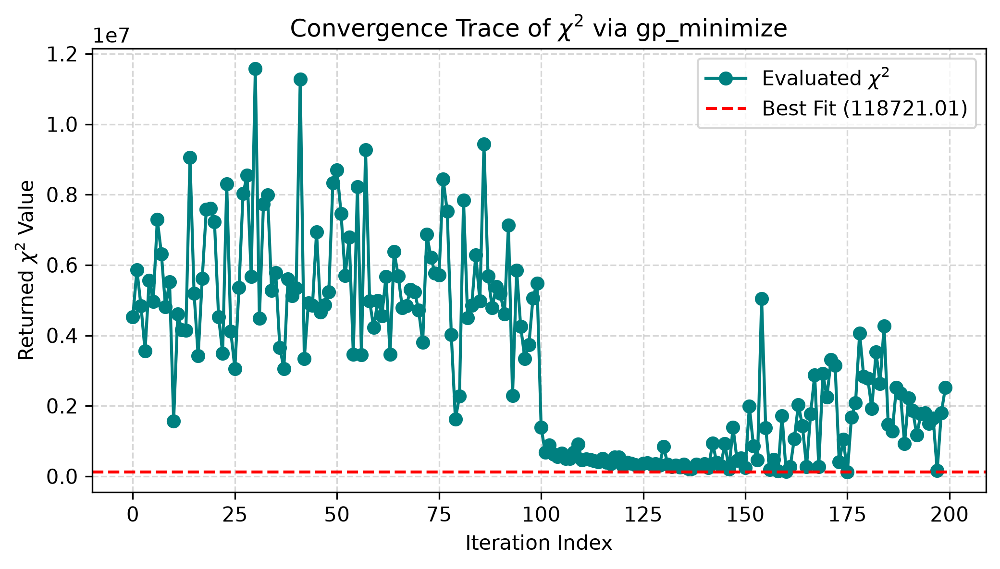
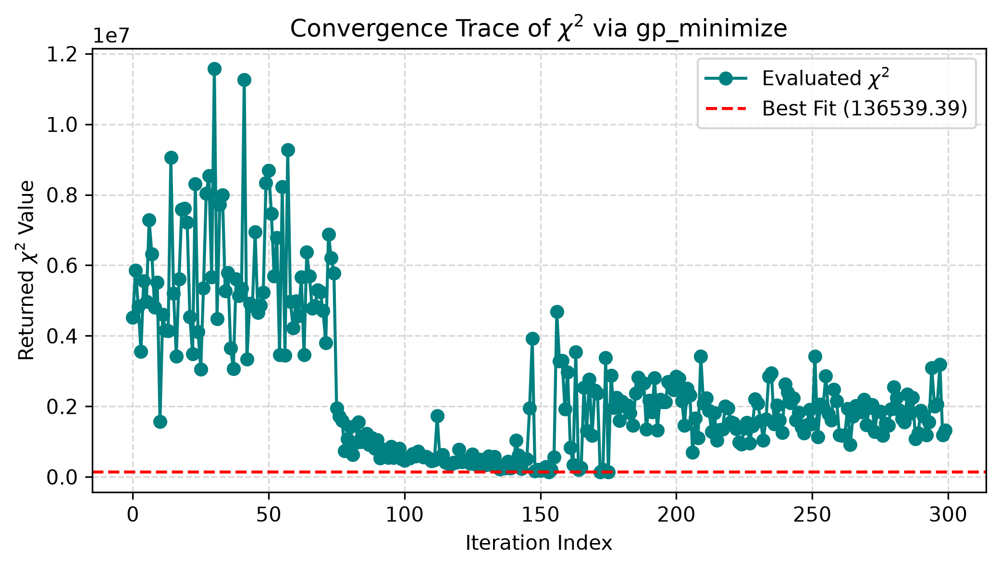

<h1> Global fitter with Bayesian optimization methods </h1>

<br>

Optimizer chosen -> gp_minimize is from the scikit-learn library

```python
bounds = []
for val in p0:
    if val == 0:
        bounds.append((-10.0, 10.0))  # Fallback range for zero parameters
    else:
        # Example: Allow the optimizer to look between 90% and 110% of the initial guess
        low_bound = min(val * 0.9, val * 1.1)
        high_bound = max(val * 0.9, val * 1.1)
        bounds.append((low_bound, high_bound))
        
popt = gp_minimize(
    func=fitter.eval_all,       
    dimensions=bounds,          
    n_calls=500000,
    n_initial_points=400000,
    acq_func='PI',
    random_state=42
)

```

What each part does:

func: this is the objective function that the minimizer  
dimensions: sets the search space  
n_calls: amount of times we are evaluating the objective function  
n_initial points: the amount of random guesses it makes initially  
acq_func: the different functions, which balance exploitation vs exploration, with exploitation being exploring directions near good results while exploration is exploring new directions   
random_state: ensures the same set of initial points is chosen every time

<h1>Graph</h1>


Things to consider: 
The difference between n_calls and n_initial points can be very small, meaning that the amount of "actual guesses" was not sufficient. The goal now is to find an ideal point where we can maximize the amount of actual guesses.

<br>



<br><br>

Following a 25% rule

<br><br>

